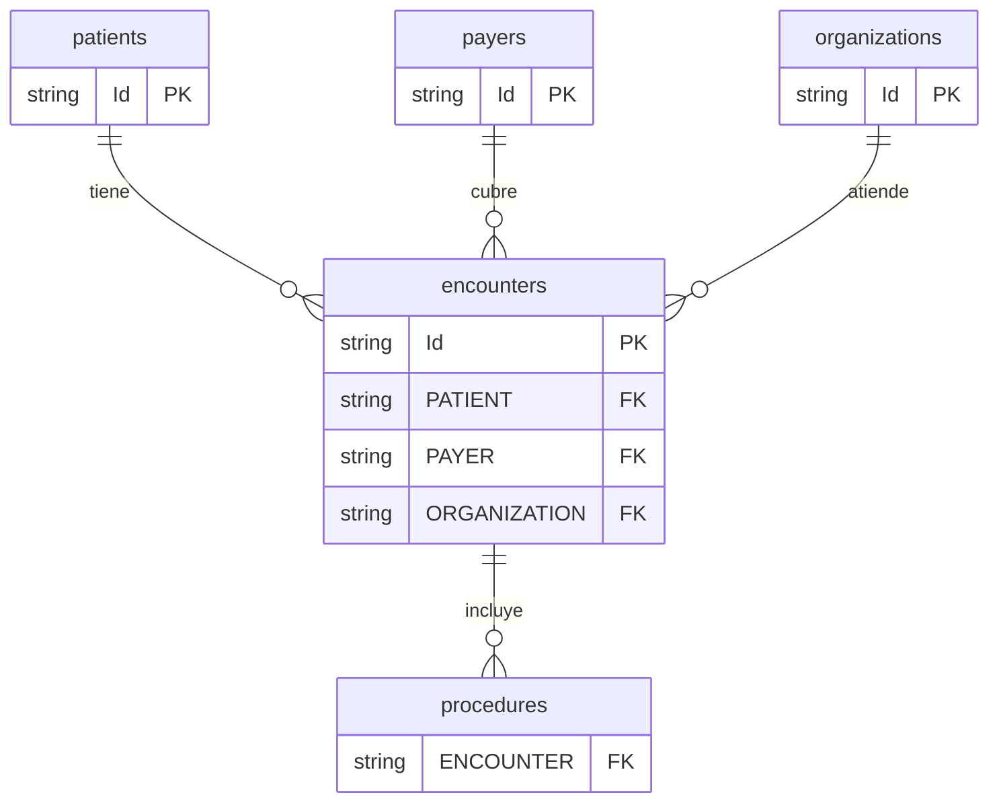

# Análisis de gestión hospitalaria: consultas, costos y cobertura

## Resumen

La dirección de un hospital quiere entender su actividad, sus costos y su cobertura de seguros para saber dónde mejorar. Los tres hallazgos principales:
- **Riesgo de cobranza:** casi la mitad de las consultas (48,7%) no tiene cobertura y los pacientes pagan el 69,4% de los costos.
- **Urgencias leves caras:** son el 13% de las consultas pero el 23% de los costos.
- **Reinternaciones concentradas:** 10 pacientes explican el 75,5% de las reinternaciones.

**Recomendaciones:**
- Ayudar a los pacientes sin seguro a inscribirse en programas públicos y ofrecerles planes de pago.
- Revisar los costos de las urgencias leves y derivar casos a consultas programadas, que son más baratas.
- Hacer un seguimiento después del alta al pequeño grupo de pacientes que más se reinterna.

## El problema de negocio

La dirección de un hospital necesita un informe de gestión para entender su actividad, sus costos y su cobertura de seguros, y detectar dónde mejorar.

Para ordenar el análisis se plantearon cuatro hipótesis (suposiciones que los datos confirman o descartan):

- **H1**: la actividad del hospital cambió mucho entre años.
- **H2**: las internaciones son pocas, pero concentran la mayor parte de los costos.
- **H3**: una parte grande de las consultas no tiene cobertura, lo que aumenta el riesgo de cobranza.
- **H4**: algunos pacientes se reinternan seguido.

## Los datos

Se usaron datos sintéticos (realistas, pero generados por computadora) del Massachusetts General Hospital, publicados por Maven Analytics con licencia de dominio público.

Abarcan desde 2011 hasta febrero de 2022 y están organizados en cinco tablas:

- **patients** (pacientes): 974 pacientes.
- **encounters** (consultas): 27.891 consultas e internaciones. Es la tabla central.
- **procedures** (procedimientos): 47.701 procedimientos.
- **payers** (aseguradoras): 10 aseguradoras. Incluye "NO_INSURANCE", que identifica las consultas sin cobertura.
- **organizations** (hospitales): 1 hospital.

El diagrama muestra cómo se conectan las tablas: un paciente puede tener muchas consultas, cada consulta tiene una aseguradora y un hospital, y una consulta puede incluir muchos procedimientos. (PK es el identificador único de cada fila; FK es el campo que la conecta con otra tabla).



## Qué encontré

### Quiénes son los pacientes

La mayoría son personas mayores que viven cerca del hospital.

- Género parejo: 494 hombres y 480 mujeres.
- Edad promedio de 68,6 años. La mediana (el valor del medio: la mitad de los pacientes tiene menos y la otra mitad más) es 70,5 años. El 37% tiene 80 años o más.
- El 66% vive en el condado de Suffolk, donde está el hospital.
- 154 pacientes fallecieron (16%).
- La edad se calculó a la fecha de fallecimiento para los fallecidos y a la última fecha de los datos (5/2/2022) para el resto.

### Cuánto cuesta una consulta

La consulta típica es barata; unas pocas muy caras hacen subir el promedio.

- Costo promedio por consulta: USD 3.640, pero la mediana es USD 279.
- La consulta más cara llega a USD 641.883.

### H1: evolución anual — SE CONFIRMA

La actividad tuvo dos picos muy marcados, en 2014 y en 2021, por motivos distintos.

- **2014**: 3.885 consultas, un 59% más que un año normal (unas 2.450). Se debe a que las consultas ambulatorias (atenciones sin internación) se duplicaron: 2.341 contra 1.073 en 2016. Ese año también concentra registros con duraciones erróneas, por lo que podría haber problemas de carga.
- **2021**: 3.530 consultas. Las consultas externas casi se triplicaron (1.418 contra 481 en 2016) por la aplicación de vacunas (1.001 consultas, probablemente asociadas al COVID-19) y la telemedicina (338). Las internaciones cayeron un 56% (55 contra 124).
- En ambos picos el costo promedio bajó, porque las consultas adicionales fueron de bajo costo.
- 2022 se excluye de las comparaciones por estar incompleto (solo hasta febrero).

### H2: costos por tipo de consulta — SE RECHAZA

Las internaciones no son las que más pesan en el costo total: pesan más las consultas ambulatorias y, sobre todo, las urgencias leves.

- Las internaciones son las consultas más caras de a una (USD 7.761 en promedio), pero como son el 4,1% de las consultas, suman solo el 8,7% del costo.
- Las consultas ambulatorias son las que más costo acumulan por su volumen: 44,9% de las consultas y 35,7% del costo.
- **Hallazgo clave**: las urgencias leves (urgent care, casos que necesitan atención rápida pero no son emergencias graves) son el 13,1% de las consultas pero generan el 23% del costo. Cuestan USD 6.369 en promedio, más del doble que una consulta ambulatoria.

### H3: cobertura — SE CONFIRMA

Casi la mitad de las consultas no tiene seguro, y la mayor parte del costo la pagan los pacientes: un riesgo alto de deudas que no se cobren.

- 13.586 consultas (48,7%) no tuvieron ninguna cobertura.
- Los seguros cubren el 30,6% del costo total; los pacientes pagan el 69,4%.
- Las consultas sin seguro suman USD 49,3 millones, casi la mitad de la facturación.
- Los programas públicos de salud de Estados Unidos son los que más cubren: Medicaid (para personas de bajos ingresos) 94%, Dual Eligible (personas que tienen Medicare y Medicaid a la vez) 89,3% y Medicare (para mayores de 65 años) 78%. Medicare es la más usada, con 11.371 consultas, en línea con la edad de los pacientes.
- Entre las privadas, Blue Cross Blue Shield cubre el 69,1%. Las demás (Humana, Aetna, UnitedHealthcare, Cigna y Anthem) cubren menos del 1%, lo que podría deberse al origen sintético de los datos.

### H4: reinternaciones — SE CONFIRMA

Las reinternaciones son frecuentes, pero se concentran en muy pocos pacientes.

- Se considera **reinternación** a una internación que empieza dentro de los 30 días posteriores al alta de una internación anterior del mismo paciente.
- Tasa de reinternación (porcentaje de internaciones que son reinternaciones): 40,4% (458 de 1.135 internaciones).
- De 153 pacientes internados, 29 (19%) se reinternaron, y solo 10 de ellos explican el 75,5% de las reinternaciones. Un mismo paciente llegó a 52.

## Cómo me aseguré de que los datos fueran confiables

Antes de sacar conclusiones, revisé errores e inconsistencias en los datos:

- **Duraciones imposibles**: 17 consultas no hospitalarias (0,06%) figuran con duraciones mayores a 24 horas, de hasta 5 años. Se consideran errores de registro. Inflaban la duración promedio de 2,1 a 7,3 horas, así que se excluyen solo del cálculo de duración.
- **Internaciones superpuestas**: 143 internaciones empiezan antes del alta de la anterior del mismo paciente. Pueden ser errores de carga o traslados.
- **Códigos postales**: estaban cargados como número y perdían los ceros iniciales. Se corrigen a texto.
- **Fechas**: incluían zona horaria; se normalizan a un mismo formato.
- **Duplicados**: las tablas de procedimientos y aseguradoras no tienen filas repetidas.
- **Privacidad**: los datos personales (nombre, dirección) se excluyen del análisis.

## Cómo está construido

Herramientas: Python (pandas, NumPy, Matplotlib) para el análisis, Power BI para el tablero y Git/GitHub para el control de versiones.

Los datos pasan por tres etapas, cada una en su carpeta:

```
data/raw      →  data/staging   →  data/marts
(originales,     (datos limpios)    (tablas finales para
nunca se                            KPIs y Power BI)
modifican)
```

- **raw** (crudo): los datos tal como se descargaron. Nunca se modifican, para poder volver siempre al origen.
- **staging** (preparación): los datos ya limpios y corregidos.
- **marts** (tablas finales): tablas listas para calcular los indicadores clave (KPIs) y armar el tablero en Power BI.

## Consideraciones

- Los datos son sintéticos: algunas magnitudes (como la cobertura de las aseguradoras privadas o la tasa de reinternación) podrían no reflejar la realidad.
- No hay pacientes menores de 26 años.
- 2022 está incompleto (solo hasta febrero).
