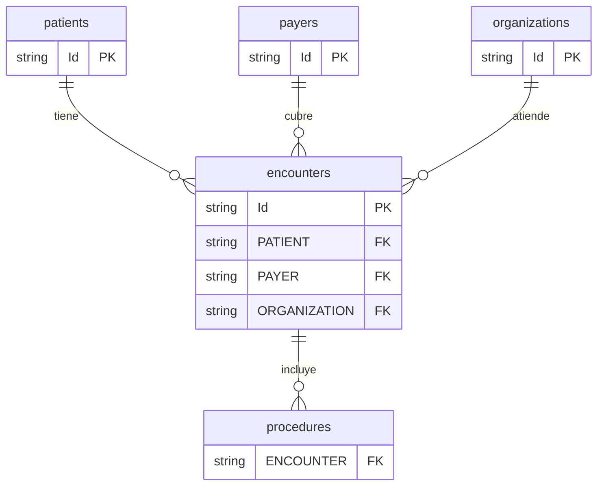

# PROYECTO INDIVIDUAL: GESTIÓN HOSPITALARIA
### Análisis de costos, cobertura y reinternaciones de un hospital

## Sumario

En este proyecto nos situamos en el rol de **Analista de Datos**, realizando la exploración y el análisis de la información de un hospital entre 2011 y 2022. El objetivo es entender hacia dónde se destina el presupuesto del hospital, quién paga las consultas y qué pacientes generan más costos, para ayudar a la dirección a tomar mejores decisiones. Para ello, realizamos un análisis exploratorio de los datos con **Python**, y a partir de los hallazgos, planteamos conclusiones y recomendaciones de negocio.

## Introducción: contexto, rol y tarea

**El contexto.** La dirección del **Massachusetts General Hospital** percibe que sus costos vienen en aumento con el paso de los años, pero no tiene claro hacia dónde se está yendo el presupuesto: qué tipo de consultas son las más costosas, cuánto de esos costos cubren los seguros y si hay pacientes que vuelven una y otra vez al hospital. Sin esa información, es difícil decidir dónde actuar.

**Nuestro rol.** Fuimos convocados como **Analistas de Datos** para estudiar la información histórica del hospital y transformarla en respuestas concretas para la dirección.

**La tarea.** Analizar las consultas, los costos, la cobertura de los seguros y las internaciones de los pacientes, verificar una serie de hipótesis planteadas junto a la dirección y proponer recomendaciones basadas en los datos.

## Descripción

El proyecto se centra en el análisis de los registros del hospital, que incluyen información sobre los pacientes (edad, género, lugar de residencia), cada consulta o internación (fecha, tipo, duración y costo), los estudios y tratamientos realizados, y las aseguradoras que cubren cada consulta.

Los datos son **sintéticos** (realistas, pero generados por computadora) y fueron publicados por **Maven Analytics** con licencia de dominio público.

## Objetivos

- Entender el perfil de los pacientes que atiende el hospital.
- Analizar la evolución de las consultas y los costos a lo largo de los años.
- Identificar qué tipos de consulta concentran el presupuesto.
- Medir qué parte de los costos cubren los seguros y qué parte pagan los pacientes.
- Detectar a los pacientes que se reinternan con frecuencia.
- Proponer recomendaciones concretas para la dirección del hospital.

## Hipótesis

- **H1:** la actividad y los costos del hospital cambiaron mucho entre años.
- **H2:** las internaciones son pocas, pero concentran la mayor parte de los costos.
- **H3:** una parte grande de las consultas no tiene cobertura, lo que aumenta el riesgo de no cobrar.
- **H4:** algunos pacientes vuelven a internarse con mucha frecuencia.

## Contenido

- **[Análisis exploratorio de los datos (notebook)](notebooks/01_exploracion.ipynb):** contiene el código en Python con el paso a paso del análisis, explicado en texto, junto con los resultados obtenidos. Se utilizaron las librerías Pandas y Matplotlib.
- **[Limpieza de los datos (notebook)](notebooks/02_limpieza.ipynb):** corrige los problemas detectados y guarda las tablas limpias en data/staging.
- **[Construcción de las tablas finales (notebook)](notebooks/03_marts.ipynb):** arma el modelo estrella para el dashboard y guarda las tablas en data/marts.
- **[Diccionario de datos](docs/data_dictionary.csv):** explica qué significa cada columna de las tablas.

## Los datos y cómo se relacionan

Trabajamos con cinco tablas, entre 2011 y febrero de 2022:

| Tabla | Qué contiene | Registros |
|---|---|---|
| **patients** | Los pacientes | 974 |
| **encounters** | Cada consulta o internación (tabla central) | 27.891 |
| **procedures** | Los estudios y tratamientos | 47.701 |
| **payers** | Las aseguradoras (incluye "NO_INSURANCE" para las consultas sin cobertura) | 10 |
| **organizations** | El hospital | 1 |

---

## Análisis exploratorio de los datos (EDA)

**Consideraciones generales:**

- Revisamos tabla por tabla, columna por columna, en búsqueda de datos faltantes, duplicados y errores.
- Convertimos las fechas a su formato correcto y calculamos nuevas columnas: la edad de cada paciente, la duración de cada consulta, el año y el monto que pagó el paciente de su bolsillo.
- Detectamos y documentamos errores en los datos (ver la sección *Calidad de los datos*).
- Para más información y profundidad en el análisis, se recomienda ingresar al **[notebook](notebooks/01_exploracion.ipynb)**.

### Perfil de los pacientes

El hospital atiende sobre todo a **personas mayores y de la zona**: la edad promedio es de 68,6 años, más de un tercio tiene 80 años o más y el 66% vive en el condado de Suffolk, donde está el hospital. El género es parejo (494 hombres y 480 mujeres) y 154 pacientes fallecieron (16%). Para más detalle, ver el **[notebook](notebooks/01_exploracion.ipynb)**.

### H1: evolución en el tiempo — SE CONFIRMA

La actividad del hospital no fue pareja: hubo dos picos. En **2014**, las consultas crecieron un 59% respecto de un año normal, por la duplicación de las consultas ambulatorias. En **2021**, las consultas externas casi se triplicaron por la aplicación de vacunas (probablemente contra el COVID-19), mientras que las internaciones cayeron un 56%. En ambos picos el costo promedio bajó, porque las consultas extra fueron de bajo costo. Para más detalle, ver el **[notebook](notebooks/01_exploracion.ipynb)**.

### H2: ¿dónde se va el presupuesto? — SE RECHAZA

Las internaciones son las consultas más caras de a una (USD 7.761 en promedio), pero como son solo el 4% del total, representan apenas el 8,7% de los costos. El presupuesto se concentra en las **consultas ambulatorias** (35,7% del costo, por su gran volumen) y, sobre todo, en las **urgencias leves**: son el 13% de las consultas pero generan el 23% de los costos. Para más detalle, ver el **[notebook](notebooks/01_exploracion.ipynb)**.

### H3: cobertura de los seguros — SE CONFIRMA

Casi la mitad de las consultas (48,7%) no tuvo ninguna cobertura, y los pacientes pagan de su bolsillo el **69,4%** de los costos. Las consultas sin seguro suman USD 49,3 millones, casi la mitad de la facturación del hospital. Los programas públicos son los que más cubren (Medicaid 94%, Dual Eligible 89,3% y Medicare 78%). Además, la parte del costo que cubren los seguros cayó del 47% en 2011 a entre el 23% y el 32% desde 2016: una parte creciente del costo recae en los pacientes. Para más detalle, ver el **[notebook](notebooks/01_exploracion.ipynb)**.

### H4: reinternaciones — SE CONFIRMA

Consideramos *reinternación* a una internación que ocurre dentro de los 30 días posteriores al alta anterior del mismo paciente. La tasa es del **40,4%**, pero el problema está muy concentrado: de 153 pacientes internados, solo 29 se reinternaron, y **10 de ellos explican el 75,5% de todas las reinternaciones** (uno solo llegó a 52). Para más detalle, ver el **[notebook](notebooks/01_exploracion.ipynb)**.

---

## Calidad de los datos

- **17 consultas** no hospitalarias tenían duraciones imposibles (de hasta 5 años). Eran solo el 0,06% de los datos, pero inflaban la duración promedio de 2,1 a 7,3 horas. Las excluimos de ese cálculo.
- **143 internaciones** empiezan antes de que termine la anterior del mismo paciente: posibles errores de carga o traslados entre áreas.
- Los **códigos postales** estaban cargados como números y perdían los ceros iniciales; los tratamos como texto.
- No encontramos filas duplicadas en las tablas de procedimientos y aseguradoras.
- Dos aseguradoras tenían el código postal con 4 dígitos porque el archivo original había perdido el 0 inicial; se completaron a 5 dígitos.
- Excluimos los **datos personales y sensibles** de los pacientes (nombre, dirección, origen étnico y coordenadas del domicilio), que no son necesarios para el análisis.

## Conclusiones y recomendaciones

- **Revisar los costos de las urgencias leves** y evaluar derivar parte de esos casos a consultas ambulatorias programadas, que son más económicas.
- **Reducir el riesgo de cobranza:** ayudar a los pacientes sin seguro a inscribirse en programas públicos (muchos son mayores de 65 años y podrían acceder a Medicare) y ofrecer planes de pago.
- **Crear un programa de seguimiento después del alta** para el grupo reducido de pacientes que concentra las reinternaciones: con pocos recursos se puede atacar gran parte del problema.

## Consideraciones

- Los datos son sintéticos, por lo que algunas magnitudes podrían no reflejar la realidad de un hospital.
- 2022 está incompleto (solo hasta febrero) y se excluyó de las comparaciones entre años.
