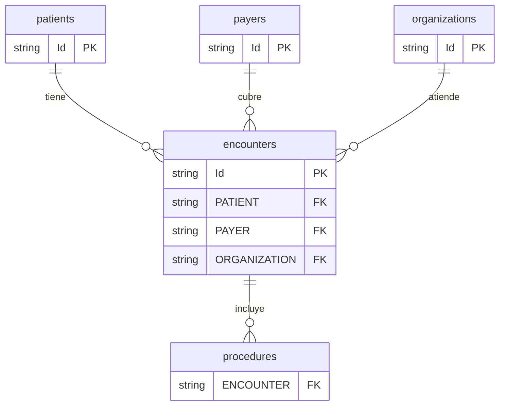

# Análisis de gestión hospitalaria: consultas, costos y cobertura

## Contexto

La dirección de un hospital necesita un informe de gestión para entender su actividad, sus costos y su cobertura de seguros, y detectar dónde mejorar. Se analizan datos sintéticos (realistas, pero generados por computadora) del Massachusetts General Hospital, publicados por Maven Analytics con licencia de dominio público.

## Datos

Período: 2011 a febrero de 2022. Cinco tablas:

- **patients**: 974 pacientes.
- **encounters**: 27.891 consultas e internaciones (tabla central).
- **procedures**: 47.701 procedimientos.
- **payers**: 10 aseguradoras (incluye "NO_INSURANCE", que identifica las consultas sin cobertura).
- **organizations**: 1 hospital.



## Arquitectura del proyecto

```
data/raw      →  data/staging   →  data/marts
(originales,     (datos limpios)    (tablas finales para
nunca se                            KPIs y Power BI)
modifican)
```

Herramientas: Python (pandas, NumPy, Matplotlib), Power BI y Git/GitHub.

## Preguntas de negocio e hipótesis

- **H1**: la actividad del hospital cambió mucho entre años.
- **H2**: las internaciones son pocas, pero concentran la mayor parte de los costos.
- **H3**: una parte grande de las consultas no tiene cobertura, lo que aumenta el riesgo de cobranza.
- **H4**: algunos pacientes se reinternan seguido.

## Hallazgos del EDA

### Perfil de los pacientes

- Género parejo: 494 hombres y 480 mujeres.
- Población mayor: edad promedio de 68,6 años (mediana 70,5); el 37% tiene 80 años o más.
- El 66% vive en el condado de Suffolk, donde está el hospital.
- 154 pacientes fallecieron (16%).
- La edad se calculó a la fecha de fallecimiento para los fallecidos y a la última fecha del dataset (5/2/2022) para el resto.

### Costos

- Costo promedio por consulta: USD 3.640, pero la mediana es USD 279: unas pocas consultas muy caras (hasta USD 641.883) inflan el promedio.

### H1: evolución anual — SE CONFIRMA

- Dos picos de actividad. **2014**: 3.885 consultas, un 59% más que un año normal (unas 2.450), por la duplicación de las consultas ambulatorias (2.341 contra 1.073 en 2016). Ese año también concentra registros con duraciones erróneas, por lo que podría haber problemas de carga.
- **2021**: 3.530 consultas. Las consultas externas casi se triplicaron (1.418 contra 481 en 2016) por la aplicación de vacunas (1.001 consultas, probablemente asociadas al COVID-19) y la telemedicina (338). Las internaciones cayeron un 56% (55 contra 124).
- En ambos picos el costo promedio bajó, porque las consultas adicionales fueron de bajo costo.
- 2022 se excluye de las comparaciones por estar incompleto (solo hasta febrero).

### H2: costos por tipo de consulta — SE RECHAZA

- Las internaciones son las consultas más caras de a una (USD 7.761 en promedio), pero como son el 4,1% de las consultas, suman solo el 8,7% del costo.
- Las consultas ambulatorias concentran el mayor costo por volumen: 44,9% de las consultas y 35,7% del costo.
- **Hallazgo clave**: las urgencias leves (urgent care) son el 13,1% de las consultas pero generan el 23% del costo (USD 6.369 en promedio, más del doble que una ambulatoria).

### H3: cobertura — SE CONFIRMA

- 13.586 consultas (48,7%) no tuvieron ninguna cobertura.
- Los seguros cubren el 30,6% del costo total; los pacientes pagan el 69,4%.
- Las consultas sin seguro suman USD 49,3 millones, casi la mitad de la facturación.
- Los programas públicos son los que más cubren: Medicaid 94%, Dual Eligible 89,3% y Medicare 78% (la más usada, con 11.371 consultas, en línea con la edad de los pacientes). Blue Cross Blue Shield cubre el 69,1%. Las demás aseguradoras privadas (Humana, Aetna, UnitedHealthcare, Cigna y Anthem) cubren menos del 1%, lo que podría deberse al origen sintético de los datos.

### H4: reinternaciones — SE CONFIRMA

- Regla de negocio: **reinternación** = internación que empieza dentro de los 30 días posteriores al alta de una internación anterior del mismo paciente.
- Tasa de reinternación: 40,4% (458 de 1.135 internaciones).
- El problema está muy concentrado: de 153 pacientes internados, 29 (19%) se reinternaron, y 10 de ellos explican el 75,5% de las reinternaciones (máximo: 52 para un mismo paciente).

## Calidad de datos

- **Validez**: 17 consultas no hospitalarias (0,06%) con duraciones mayores a 24 horas, de hasta 5 años, consideradas errores de registro. Inflaban la duración promedio de 2,1 a 7,3 horas. Se excluyen solo del cálculo de duración.
- **Internaciones superpuestas**: 143 internaciones empiezan antes del alta de la anterior del mismo paciente: posibles errores de carga o traslados.
- **Códigos postales**: cargados como número, pierden los ceros iniciales. Se corrigen a texto.
- **Fechas**: tienen zona horaria; se normalizan.
- **Unicidad**: procedures y payers no tienen filas duplicadas.
- **Privacidad**: los datos personales (nombre, dirección) se excluyen del análisis.

## Recomendaciones preliminares

- Revisar los costos de las urgencias leves y evaluar derivar casos a consultas ambulatorias programadas.
- Ayudar a los pacientes sin seguro a inscribirse en programas públicos (muchos son mayores de 65 años) y ofrecer planes de pago para reducir la deuda incobrable.
- Crear un programa de seguimiento después del alta para el grupo reducido de pacientes que concentra las reinternaciones.

## Limitaciones

- Datos sintéticos: algunas magnitudes (como la cobertura de las aseguradoras privadas o la tasa de reinternación) podrían no reflejar la realidad.
- No hay pacientes menores de 26 años.
- 2022 está incompleto.

## Estado del proyecto

En curso. Etapa completada: análisis exploratorio (EDA). Próximas etapas: limpieza de datos (staging), construcción de tablas finales (marts), dashboard en Power BI y conclusiones finales.
